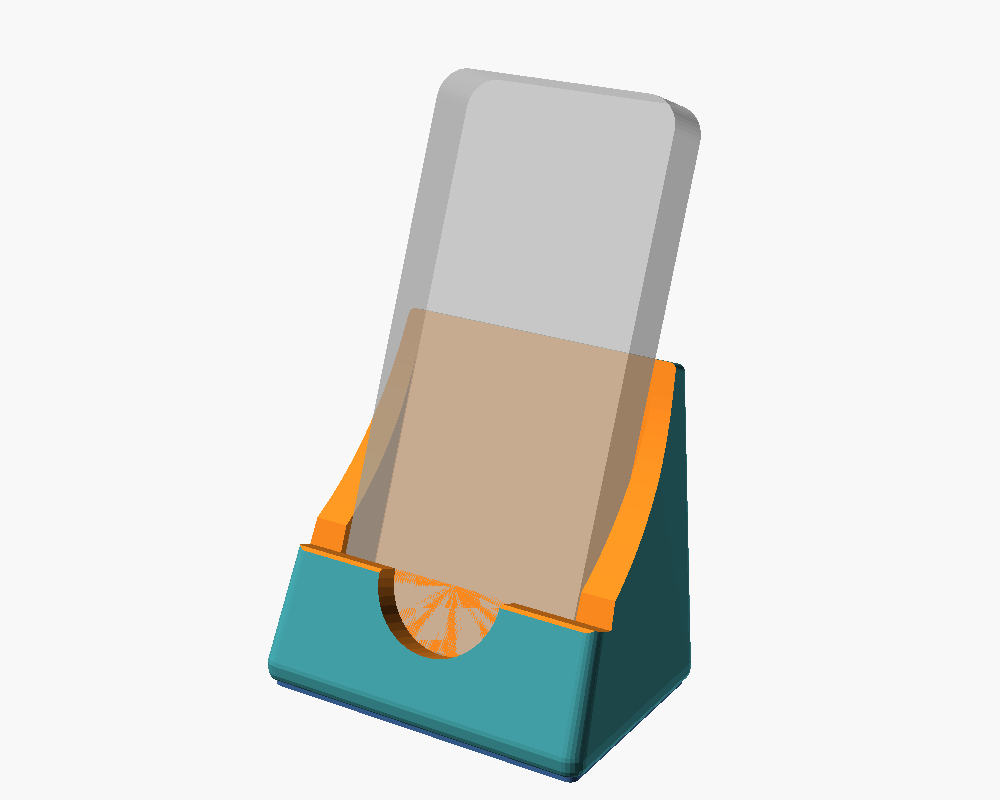
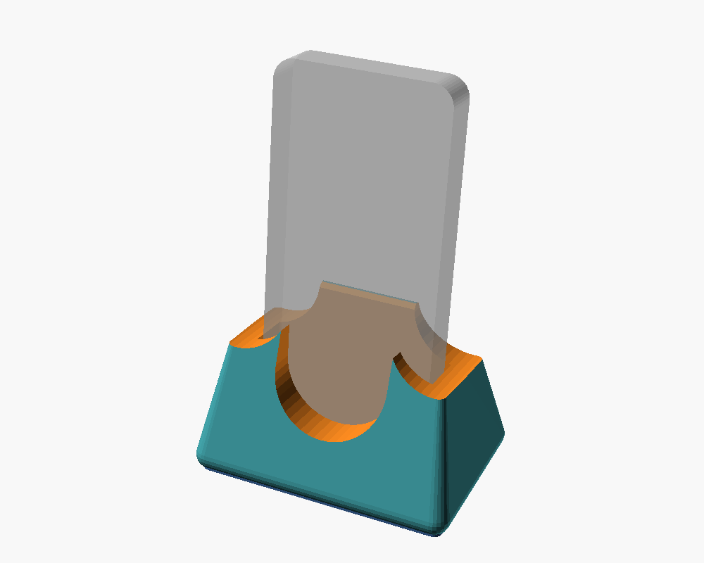
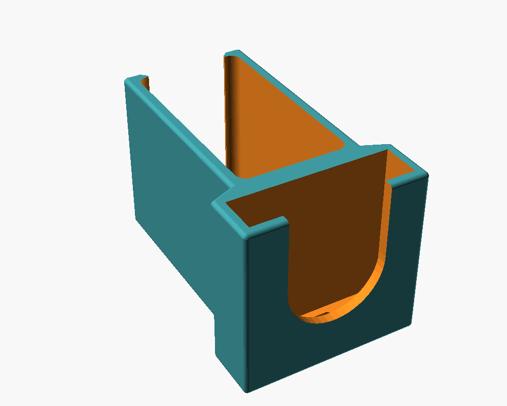
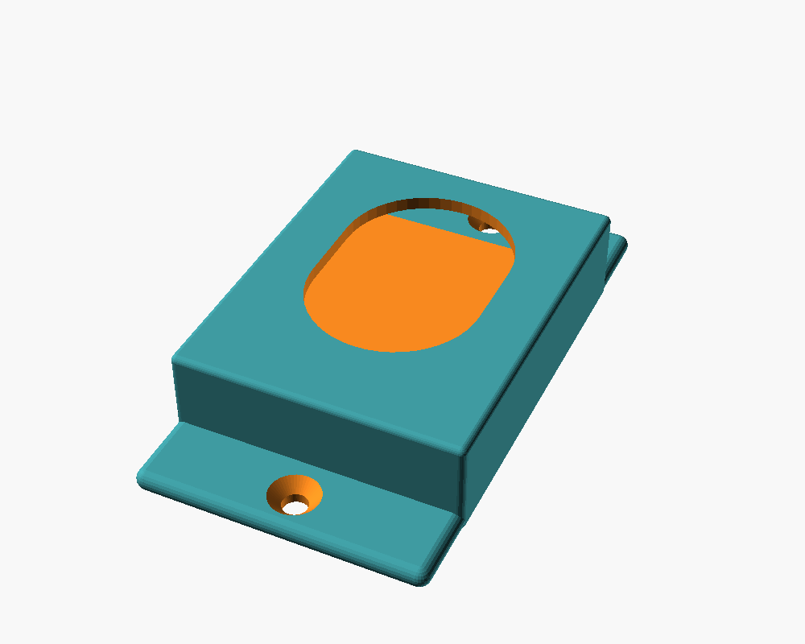
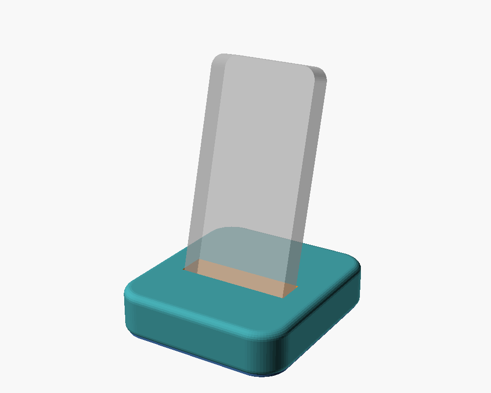
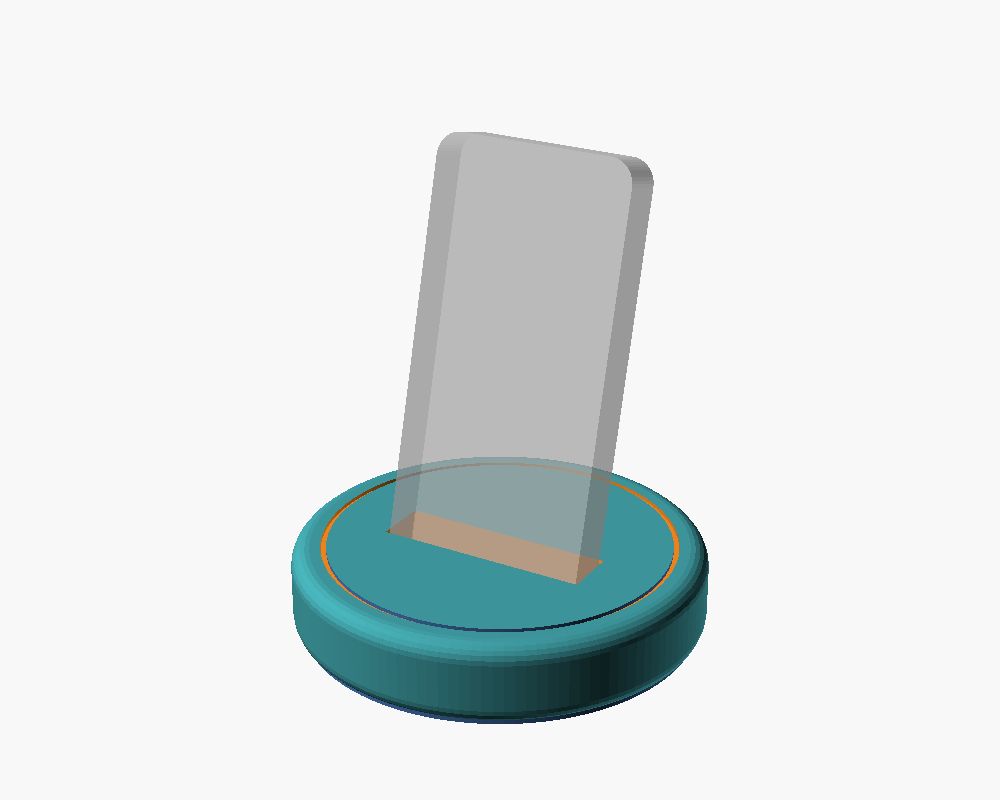
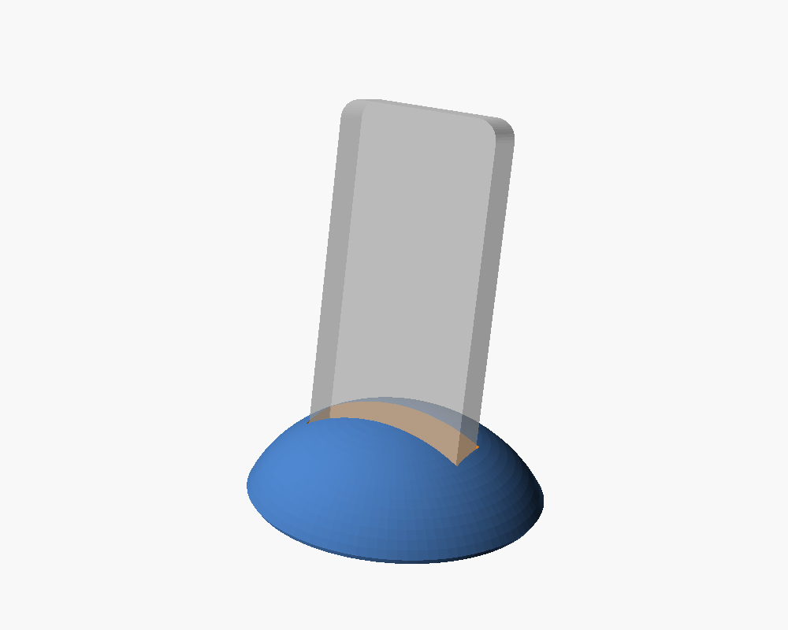
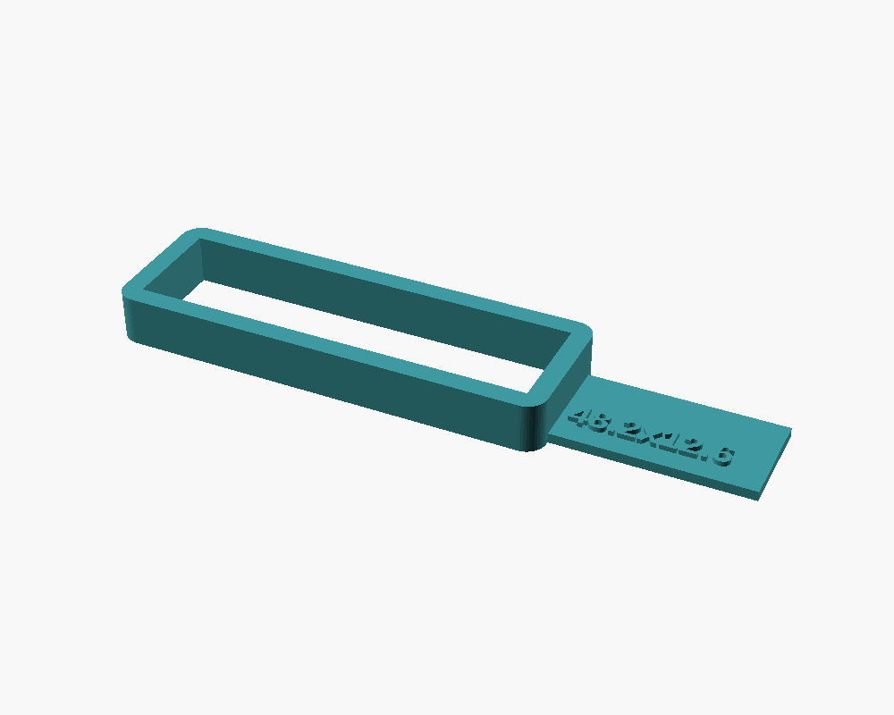
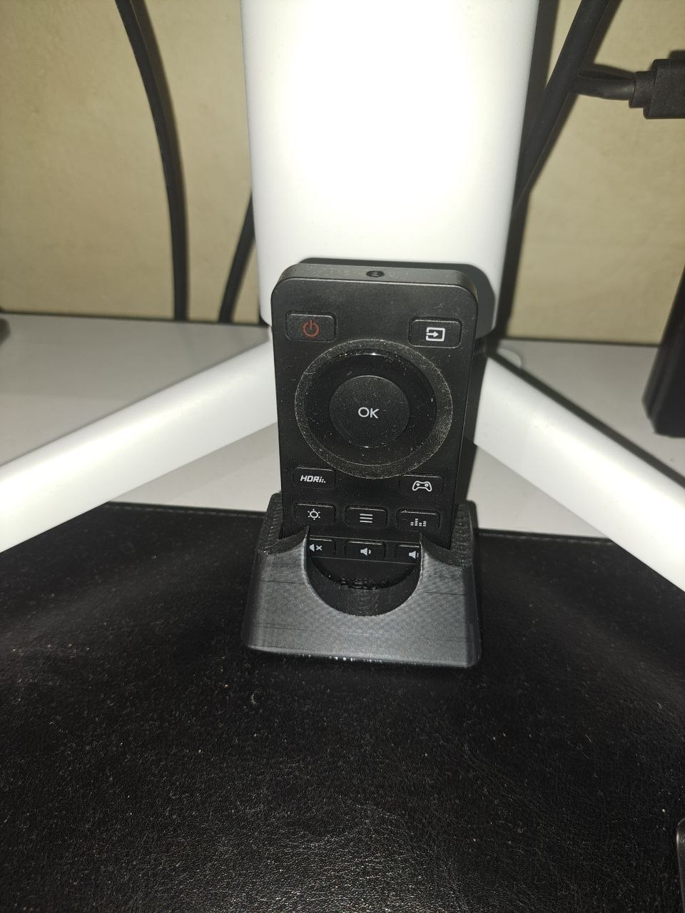

# BenQ RC-0013 Remote Stands (EX271Q, EX2710U, EX3210U and more)

Parametric, 3D-printable OpenSCAD stands for the **BenQ RC-0013** remote. It ships with the **EX271Q** and several other BenQ MOBIUZ monitors (see [Compatible monitors](#compatible-monitors)).
There are seven designs: desk docks, a monitor-neck clip and an under-desk holster. Each one comes as ready-to-print STL and 3MF files.

All of them read the remote's size from one file, [`remote_dims.scad`](remote_dims.scad). Change a number there and re-export.



## Gallery

The grey ghost in each render is the remote. It shows up in the OpenSCAD preview only and is never exported.

| V1 · Lectern | V2 · Monolith | V3 · Sidecar | V4 · Holster |
|:---:|:---:|:---:|:---:|
|  |  |  |  |
| Angled desk cradle | Upright dock with a front window | Clips onto the monitor's neck | Sleeve for the side or underside of a desk |

| V5 · Pedestal | V6 · Puck | V7 · Pebble | Fit-test ring |
|:---:|:---:|:---:|:---:|
|  |  |  |  |
| Minimal slab with a leaning slot | Round disc with an inlaid ring | Smooth dome, deepest grip | Optional ~10 min print to check the fit |

For an offline view of all renders, open [`out/previews/gallery.html`](out/previews/gallery.html) in a browser.

## Real-life print

V2 Monolith dock printed in Numaker PLA+ (black), holding the RC-0013 remote on a desk next to the monitor stand:



| Design | Status |
|---|---|
| V2 · Monolith | **Printed and tested** in Numaker PLA+. The current `remote_dims.scad` values (100 × 45.8 × 10.2 mm remote, `clearance = 1.2`, giving a 48.2 × 12.6 mm pocket) give an easy drop-in fit with a little play. |
| V1, V3–V7, fit-test ring | Not printed yet. They use the same dimensions, so they should fit, but nobody has confirmed it. |

### Contributing

If you print any of these, please share how it went. Open an issue or a pull request with a photo, your printer, filament and slicer settings, and how the remote fit (tight, good or loose, and any `clearance` change you made). Fixes and new designs are welcome too. Add photos to [`photos/`](photos) as `<design>_<your-name>.jpg`.

## Compatible monitors

BenQ uses the same RC-0013 remote across several MOBIUZ monitors, so every design here fits all of them. Each model below lists "Remote Control (RC-0013, CR2032)" in the box contents of its BenQ user manual:

| Monitor | Size |
|---|---|
| EX271Q | 27" QHD |
| EX271U | 27" 4K |
| EX2710U | 27" 4K |
| EX2710R | 27" QHD curved |
| EX3210U | 32" 4K |
| EX3210R | 32" QHD curved |
| EX321UX | 32" 4K Mini LED |
| EX381U | 38" 4K |

Regional variants with an `E` suffix (EX2710UE, EX3210UE, EX2710RE, EX3210RE) share the same manuals and remote. If your monitor isn't listed, check its manual for "RC-0013". For the V3 neck clip, measure your own monitor's neck (see [Customising](#customising-and-exporting)), since stands differ between models.

## Quick start

1. Pick a design from the table below.
2. Slice the matching file from [`out/`](out). Use `.3mf` for Bambu Studio, PrusaSlicer or Orca, and `.stl` for anything else.
3. Print it as exported. None of the designs need supports.

On a different printer or filament, print `out/fit_test.stl` first (see [Fit](#fit)).

## Designs

| | File | Style | Print notes |
|---|---|---|---|
| V1 | [`v1_lectern_cradle.scad`](v1_lectern_cradle.scad) | Angled desk cradle with curved cheeks and a scalloped lip | As exported, 3 walls, 15–20% infill |
| V2 | [`v2_monolith_dock.scad`](v2_monolith_dock.scad) | Tapered upright dock with a front window, pinch scallops and a chamfered lead-in | As exported, 3 walls, 20%+ infill |
| V3 | [`v3_neck_clip.scad`](v3_neck_clip.scad) | Snaps onto the monitor stand's neck. **Measure the neck first** (`neck_w`, `neck_d`) | PETG preferred (the arms flex), 4 walls |
| V4 | [`v4_desk_pocket.scad`](v4_desk_pocket.scad) | Sleeve that screws on (M4 / #8 countersunk) or tapes on to the side or underside of a desk | Exported lying on its side, 3 walls, 20% infill |
| V5 | [`v5_pedestal.scad`](v5_pedestal.scad) | Low square slab, remote leans back 15° in a slot | 4 walls, 60–100% infill (weight = stability) |
| V6 | [`v6_puck.scad`](v6_puck.scad) | Round disc with an inlaid ring. Pause at the ring layer to swap colours for a two-tone ring | 4 walls, 60–100% infill |
| V7 | [`v7_pebble.scad`](v7_pebble.scad) | Smooth river-stone dome, ~18 mm deep grip | 4 walls, 40–100% infill, 0.12 mm layers for a smoother dome |

All designs print at 0.2 mm layers. The desk stands (V1, V2, V5, V6, V7) have recesses for 8 mm stick-on rubber feet.

## Remote dimensions

**100 × 45.8 × 10.2 mm with 5.5 mm corners.** BenQ doesn't publish these. Two independent sources agree:

| Source | Width | Thickness | Length |
|---|---|---|---|
| Seller listing (3.94 × 1.8 × 0.4 in) | 45.7 | 10.2 | 100 |
| MakerWorld "BenQ Remote Holder – Under Desk" pocket, minus its even ~2.25 mm/side slack | 45.95 | 10.24 | 98.6–100.4 |

According to BenQ's quick-start guide, the bump on the bottom edge is the CR2032 battery's pull-tab. Every pocket has a relief for it, so the remote sits flat even with the tab still in.

## Fit

`clearance` in `remote_dims.scad` is **1.2 mm per side**, which makes the pocket 48.2 × 12.6 mm. The first test print at 0.6 mm gripped the remote too tightly, so the exports in `out/` are tuned for an easy drop-in fit with about 0.6 mm of real play per side.

On a new printer or filament:

1. Print `out/fit_test.stl`, a ~10 minute ring labelled with its pocket size.
2. Slide the remote through it. It should pass with a little play.
3. If it's tight, raise `clearance`. If it rattles, lower it. Then re-export.

## Customising and exporting

Open any `.scad` file in [OpenSCAD](https://openscad.org). Press F5 to preview it with the ghost remote, or F6 to render. To export from the command line:

```sh
openscad -o out/v2_monolith_dock.stl v2_monolith_dock.scad
openscad -o out/v2_monolith_dock.3mf v2_monolith_dock.scad
```

Useful parameters:

- `remote_dims.scad`: `remote_l`, `remote_w`, `remote_t`, `remote_r`, `clearance`. Every design picks these up.
- `v3_neck_clip.scad`: `neck_w`, `neck_d`, `neck_clear`. BenQ doesn't publish neck sizes for any of these monitors, so these are placeholders. Measure your own.
- `v4_desk_pocket.scad`: set `print_flat = false` to preview it the way it mounts.
- `lean` in V5–V7 sets the tilt angle.

## Repository layout

```
remote_dims.scad          shared remote size, clearance and helper modules
v1 … v7_*.scad            the seven stand designs
fit_test.scad             fit-test ring
out/*.stl, out/*.3mf      ready-to-print exports
out/previews/             renders + gallery.html
photos/                   real-life photos of printed stands
benq-remote-stands.zip    everything above in one download
```

## License

[GNU AGPL-3.0](LICENSE) © Shaan Shoukath
